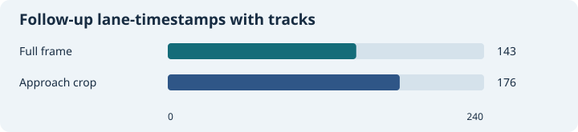

# Traffic Signal Queue Estimator

Portfolio by [Khush Bhavin Maru](https://github.com/Khushx11) · Adelaide University MAAIM.

A local research prototype for estimating per-lane queues from fixed-camera
recordings of signalised intersections. The research question is whether lane
geometry and temporal tracking improve counts under occlusion at unseen
intersections.

## Evidence at a glance

- **Roadside video.** The [U.S. DOT roadside pilot](docs/roadside-camera-data.md)
  includes verified daytime and night recordings from a fixed signalised
  intersection. Inference can retain the publisher capture clock for
  reference joins and the playback clock for browser seeking.
- **Detector benchmarks.** [TrafficCAM fine-tuning](docs/detector-robustness.md)
  improved frame counts on TrafficCAM and worsened them on MIO-TCD. The
  [aerial spot check](results/peachtree-visible-spot-check.json) measures
  matches to manually marked vehicles on two frames.
- **Queue accuracy.** A held-out real-video benchmark still needs complete
  cycles, verified phase-to-lane mappings and independent full queue counts.
  The supplied [synthetic fixture](fixtures/occlusion.json) exercises queue
  state transitions. Australian external validation is pending.

## Run the local workspace

Use Python 3.9 or later. The video dependency file records the versions used on
an Apple Silicon Mac. The browser viewer also works without the model through
a static server.

```sh
python3 -m venv .venv
.venv/bin/pip install -r requirements-video-pilot.txt
mkdir -p data/local runs
curl -fL https://github.com/ultralytics/assets/releases/download/v8.3.0/yolo11n.pt \
  -o data/local/yolo11n.pt
.venv/bin/python scripts/serve.py --weights data/local/yolo11n.pt
```

Open `http://127.0.0.1:8000`. Review the synthetic sample, or select a
browser-playable local recording and its matching camera JSON, then choose
**Run local inference**. The loopback server accepts the original camera
layout or the compiled configuration. Videos stay on the local machine.
The review workspace also accepts existing prediction JSON and exports CSV/JSON.
Use **Mark camera geometry** to mark a single lane on a paused frame and
download a layout JSON. Enter measured ground width and depth. For multiple
lanes or a non-rectangular anchor layout, configure the JSON directly. See [the Peachtree example](configs/peachtree-camera1-pilot.json).
The example applies to the original 640 × 480 camera view and uses approximate
ground dimensions.

For viewer-only use, run
`python3 -m http.server --bind 127.0.0.1 --directory web 8000`.
If a raw FHWA AVI cannot play in the browser, transcode it locally to MP4
without changing the camera geometry or frame cadence.

## Reproduce the FHWA pilot

```sh
python3 scripts/download_raw.py data/local/peachtree-cam1.avi
.venv/bin/python scripts/calibrate.py configs/peachtree-camera1-pilot.json runs/camera.json
.venv/bin/python scripts/infer.py data/local/peachtree-cam1.avi runs/camera.json \
  runs/peachtree.json --recording peachtree-cam1-pm \
  --weights data/local/yolo11n.pt --max-frames 120
```

The raw downloader retrieves the exact Peachtree archive member and checks ZIP
integrity and SHA-256. A full decode of the verified camera 1 member yielded
1,714 frames and a corrupt-frame warning. Camera 4 yielded 2,534 frames and
also reported frame corruption. These are usable pilot excerpts where pixels
decode. Their annotation clocks and cycle coverage remain unverified. See [source and licence notes](docs/data-pilot.md) and
[the asset ledger](data/verified-assets.json). The original archive inventory
tool is intended for processed/reference assets. Processed footage contains
baked-in vehicle annotations and belongs outside detector input.

Use `--approach-crop` for the diagnostic crop. Pass `--phase-events` only
after verifying alignment. A phase file maps each lane to an object with a
`source` and an ordered `events` list. Each event has recording-relative
`time` in seconds and `phase` set to red, amber, green or null. No phase is
shown before the first event.

An optional `reviewed_empty` map in a camera layout records manually reviewed
empty-lane intervals. Each lane has a `source` and a sorted `intervals` list of
`[start, end]` seconds with exclusive ends. Conflicting track observations
cancel the supplied empty evidence. Confirmed zeros export their provenance.
Run held-out benchmarks without this evidence. The evaluator rejects assisted
zeros by default and reports them separately only with `--allow-reviewed-empty`.

## Peachtree diagnostic



The original Peachtree pilot emitted 1,758 unsupported zeros. The revised
baseline abstained on all 240 lane-timestamps in a 120-frame follow-up.
Cropping recovered tracks at 33 additional lane-timestamps. See the
[smoke-test report](docs/smoke-test.md).

## Detector robustness experiment

[Reproduce the TrafficCAM fine-tuning and MIO-TCD evaluation](docs/detector-robustness.md).
TrafficCAM fine-tuning cut in-domain frame-count MAE from **17.24 to 9.91**,
but raised external MIO-TCD MAE from **1.30 to 2.20**. The general default
remains the pretrained checkpoint. These metrics measure vehicles in frames.
Signal-cycle queue accuracy still needs an independently aligned reference.

The experiment adds a supervised fixed-camera detector candidate and tests
separate camera footage, small vehicles, and controlled blur, darkness,
resolution loss and occlusion. The [sampled image IDs](results/detector-split-manifest.json)
and [archive hashes](data/detection-benchmark-assets.json) record the data used.

## Evaluation and tests

```sh
python3 -m unittest discover -s tests -v
python3 scripts/run_fixture.py fixtures/occlusion.json
npm ci
npx playwright install chromium
npm test
```

Follow the [reference protocol](docs/annotation.md) when preparing benchmark
data. Cycle peak scoring requires verifying the cycle bounds and providing
every expected timestamp. No audited real-data reference file is bundled.
Once you supply independent labels, run
`python3 scripts/evaluate.py audited-reference.json runs/peachtree.json --split test`.
For an aligned publisher capture clock use `--join-clock capture`.

The [synthetic recovery results](results/synthetic-recovery.json) exercise
queue state transitions in isolation. The browser tests exercise the
synthetic sample, import, seeking, exports and the upload request flow.

GitHub CI runs the real model on the bundled synthetic clip. Run the same
browser integration test locally with the installed model dependencies and checkpoint.

```sh
QUEUE_REAL_INFERENCE=1 QUEUE_VIDEO_PYTHON=.venv/bin/python   QUEUE_VIDEO_WEIGHTS=data/local/yolo11n.pt npm test -- --workers=1
```

## Aerial-camera option

A manually reviewed Peachtree camera 4 diagnostic found 12 of 14 marked
vehicle appearances with the aerial checkpoint on full frames, and 13 of
14 with a crop. The labels cover seven selected vehicles on each of two
frames. See the [scope and raw results](docs/data-pilot.md#camera-4-manual-detection-check).

To try it on an elevated view, download the [official YOLO11n-OBB checkpoint](https://github.com/ultralytics/assets/releases/download/v8.3.0/yolo11n-obb.pt)
and pass its local path to `scripts/infer.py --weights` or
`scripts/serve.py --weights`. The tested checkpoint SHA-256 is
`b62898ebf38940ca4df323863e45ee9d84a1a46d5d11ebdde529fb33aa9f3a32`.
ByteTrack uses the oriented detections and the app displays their enclosing
rectangles. The broader-view checkpoint remains the general default.

## Source terms

Downloaded data and checkpoint files are kept outside the repository.
See the [roadside source guide](docs/roadside-camera-data.md), [FHWA data
notes](docs/data-pilot.md) and [detector sources](docs/detector-robustness.md)
for publisher terms. This repository currently has no project-level licence.
