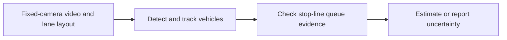

# Traffic Signal Queue Estimator

Portfolio by [Khush Bhavin Maru](https://github.com/Khushx11) · Adelaide University MAAIM.

A local research prototype for estimating per-lane queues from fixed-camera
recordings of signalised intersections. The research question is whether lane
geometry and temporal tracking improve counts under occlusion at unseen
intersections.

**Current result.** The raw Peachtree pilot exposed a detector coverage failure.
The original run emitted 1,758 zero counts despite visible queues. The revised
pipeline reports insufficient evidence as uncertain. Both full-frame and
approach-cropped inference abstained on all 240 lane-timestamps in the same
120-frame follow-up. Cropping increased the number of lane-timestamps with
tracks from 143 to 176, but it did not recover a trustworthy stop-line-connected
queue. See the [audit follow-up](docs/smoke-test.md). Real-world count accuracy
and Australian external validation remain unverified.


## Traffic queue workflow




Both modes abstained on all 240 lane-timestamps. Having tracks available did not establish a trustworthy queue count.

## Run the local workspace

Use Python 3.9 or later. The video dependency file records the versions used on
an Apple Silicon Mac. The browser viewer also works without the model through
a static server.

```sh
python3 -m venv .venv
.venv/bin/pip install -r requirements-video-pilot.txt
mkdir -p data/local runs
curl -fL https://github.com/ultralytics/assets/releases/download/v8.3.0/yolo11n.pt \
  -o data/local/yolo11n.pt
.venv/bin/python scripts/serve.py --weights data/local/yolo11n.pt
```

Open `http://127.0.0.1:8000`. Review the synthetic sample, or select a
browser-playable local recording and its matching camera JSON, then choose
**Run local inference**. The loopback server accepts the original camera
layout or the compiled configuration. Videos stay on the local machine.
The review workspace also accepts existing prediction JSON and exports CSV/JSON.
Mark lane polygons, stop points and four matching image/ground anchors in
a layout JSON such as [the Peachtree example](configs/peachtree-camera1-pilot.json).
The example applies to the original 640 × 480 camera view and uses approximate
ground dimensions.

For viewer-only use, run
`python3 -m http.server --bind 127.0.0.1 --directory web 8000`.
If a raw FHWA AVI cannot play in the browser, transcode it locally to MP4
without changing the camera geometry or frame cadence.

## Reproduce the FHWA pilot

```sh
python3 scripts/download_raw.py data/local/peachtree-cam1.avi
.venv/bin/python scripts/calibrate.py configs/peachtree-camera1-pilot.json runs/camera.json
.venv/bin/python scripts/infer.py data/local/peachtree-cam1.avi runs/camera.json \
  runs/peachtree.json --recording peachtree-cam1-pm \
  --weights data/local/yolo11n.pt --max-frames 120
```

The raw downloader retrieves the exact Peachtree recording and checks ZIP
integrity and SHA-256. See [source and licence notes](docs/data-pilot.md) and
[the asset ledger](data/verified-assets.json). The original archive inventory
tool is intended for processed/reference assets. Processed footage contains
baked-in vehicle annotations and belongs outside detector input.

Use `--approach-crop` for the diagnostic crop. Pass `--phase-events` only
after verifying alignment. A phase file maps each lane to an object with a
`source` and an ordered `events` list. Each event has recording-relative
`time` in seconds and `phase` set to red, amber, green or null. No phase is
shown before the first event.

## Detector robustness experiment

[Reproduce the TrafficCAM fine-tuning and MIO-TCD evaluation](docs/detector-robustness.md).
TrafficCAM fine-tuning cut in-domain frame-count MAE from **17.24 to 9.91**,
but raised external MIO-TCD MAE from **1.30 to 2.20**. The general default
remains the pretrained checkpoint. These metrics measure vehicles in frames.
Signal-cycle queue accuracy still needs an independently aligned reference.

The experiment adds a supervised fixed-camera detector candidate and tests
separate camera footage, small vehicles, and controlled blur, darkness,
resolution loss and occlusion. The [sampled image IDs](results/detector-split-manifest.json)
and [archive hashes](data/detection-benchmark-assets.json) record the data used.

## Evaluation and tests

```sh
python3 -m unittest discover -s tests -v
python3 scripts/run_fixture.py fixtures/occlusion.json
python3 scripts/evaluate.py audited-reference.json runs/peachtree.json --split test
npm ci
npx playwright install chromium
npm test
```

Follow the [reference protocol](docs/annotation.md) when preparing benchmark
data. Cycle peak scoring requires verifying the cycle bounds and providing
every expected timestamp. No audited real-data reference file is bundled.
The [synthetic recovery results](results/synthetic-recovery.json) exercise
queue state transitions in isolation. The browser tests exercise the
synthetic sample, import, seeking, exports and the upload request flow.
